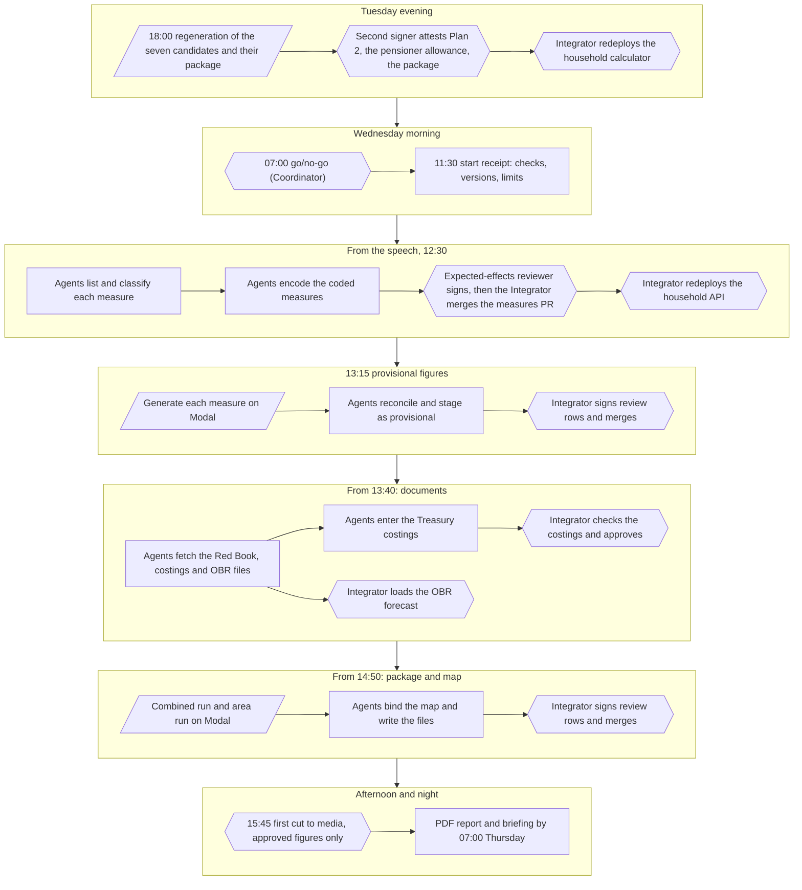
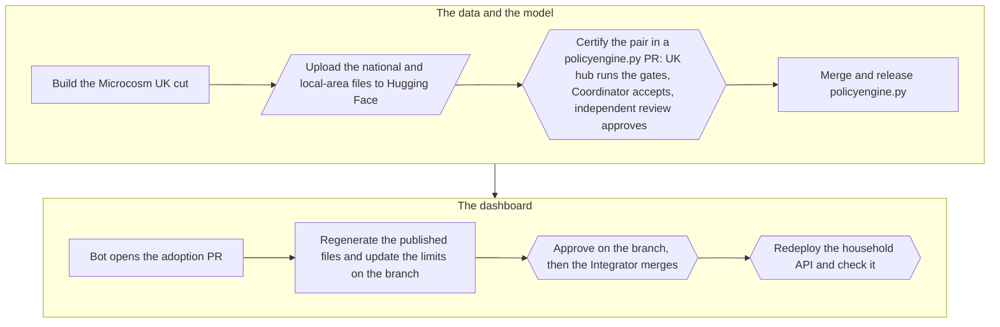

# Budget day at a glance (28 October 2026)

A one-page map of the day for people: what happens, in what order, and who acts. The steps' detail is in the [checklist](budget-day-checklist.md) and the [runbook](budget-day-runbook.md), the agents' commands are in [`budget-day-agents.md`](budget-day-agents.md), and every signature is in [`budget-day-people.md`](budget-day-people.md). Times are UTC, which is UK time this week.

Shapes in the maps:
- rectangles: agents' steps;
- slanted boxes: runs on Modal;
- hexagons: a person signs, decides or merges.

## The day

1. **Tuesday evening.**
   - At 17:30 calculation code freezes (#222).
   - At 18:00 the Coordinator regenerates the seven candidates and their package on Modal.
   - The second signer then attests the three hand-written receipts.
   - The household calculator is redeployed from the same commit before 08:00 (#231).
2. **Wednesday morning.**
   - The Coordinator holds the go/no-go at 07:00. After it, only an emergency revert changes the release.
   - By 11:30 the start receipt records the code, data, versions and limits (G0).
3. **The speech, 12:30.** Agents list every measure and sort it: parameter change, template, hand-written code, ledger only, or not computable.
   - They encode the coded ones in one measures PR.
   - The expected-effects reviewer signs each new measure's direction before it merges.
   - The Integrator merges the PR, then redeploys the household API so the calculator knows the new measures.
4. **Provisional figures, 13:15** (G2).
   - Each measure runs in its own Modal container: 6 to 16 min on 6.11.1 (#250).
   - Agents reconcile and stage the measures as provisional.
   - The Integrator signs the review rows and merges, and the page shows "statement figures, awaiting Treasury costing".
5. **Documents, from about 13:40** (G3).
   - Agents fetch the Red Book, the Treasury's policy costings and the OBR's outlook, recording each file's time and hash.
   - Agents enter the Treasury costings, and the Integrator checks them.
   - Agents reconcile each measure against the static costing, and the Integrator approves it.
   - The Integrator loads the OBR forecast.
   - Once those inputs are in, agents also write the official costings comparison and the OBR's effect on CPI.
6. **Package and map, from 14:50** (G4).
   - The combined run (about 7 min) and the area run (about 55–60 min with the Warm Home Discount top-up and Plan 2) start together on Modal.
   - Then agents bind the map, and the Integrator signs the review rows and merges. The map is live about 20–25 min after the area run ends (#250).
7. **Afternoon and night.**
   - The first cut goes to media at 15:45: approved figures from one manifest revision only, after a comparables review.
   - Overnight, the PDF report (#227, a draft) and the briefing are built from approved entries, by 07:00 on Thursday.
8. **Any time: a correction.** Withdraw the measure, fix it, redeploy the API, regenerate, attest again, and republish (G5). If the page itself breaks, roll back.

## How data reaches the dashboard

1. **Build.** The UK hub builds a Microcosm UK cut from the survey data: a national file, and a local-area file for constituencies.
2. **Upload.** Both go to the private Hugging Face repository `policyengine/populace-uk-private`, each under its own tag.
3. **Certify.** A policyengine.py pull request pins the cut to the policyengine-uk version it was built with. The UK hub runs the certification gates on its host, the Coordinator accepts the gates that need review, and an independent review of the evidence approves it. For 6.11.1 that was policyengine.py#720.
4. **Release.** Merging releases a new policyengine.py version to PyPI, with the model and data bound by one certificate. Certification and release took about 4.5 h for 6.10.0 (runbook, "Rolling re-cuts").
5. **Adopt.** The dashboard's bot opens a draft "Adopt policyengine X" pull request, as for #237. On its branch:
   - the limits the new pair lifts or adds are updated;
   - the published files (the outlook, the examples, the policy table) and every published measure are regenerated;
   - review rows are signed;
   - approvals are made before the merge.
6. **Merge and deploy.** The Integrator merges with a merge commit, and its revert PR is opened as a draft at once. The household API is redeployed (Cloud Run and Modal) and checked, and one breakdown is timed under 200 s.
7. **Budget day itself:** no adoption after the 07:00 go/no-go. Only an emergency revert to the previous release (runbook, "Rolling re-cuts").
